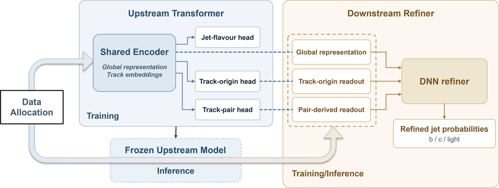

# SerialFlavour

SerialFlavour studies post-hoc refinement of multi-task jet flavour tagging on ATLAS Open Data. It asks whether lightweight downstream classifiers can improve on a GN2-inspired Transformer by using its learned representations and auxiliary predictions about track origins and shared vertices. The experiments compare embedding-only, auxiliary-feature, and graph-based refiners across training-data sizes, upstream/downstream allocations, and tagging working points.

## Pipeline



1. **Train the upstream Transformer.** A GN2-inspired Transformer learns a shared representation from jet and track features. It is trained jointly to classify jet flavour, predict each track's origin, and predict whether two tracks come from the same vertex.
2. **Freeze the Transformer and train the refiners.** The selected upstream checkpoint produces fixed inputs for downstream training. The tabular refiners use the pooled jet embedding, with optional features derived from track-origin and track-pair predictions. The graph refiner uses frozen track embeddings as nodes and predicted pair probabilities as edge weights. All refiners train on jet-flavour labels.
3. **Evaluate both stages on held-out jets.** The standard allocation scan uses disjoint upstream and downstream training partitions. The Transformer and refiners are evaluated on the same held-out Y-test sample within each configuration, comparing background rejection at fixed tagging efficiencies.

## Run a training experiment

Install the dependencies with Python 3.11 or later from the repository root.

```sh
python -m pip install -r requirements.txt
```

The [3M-jet, 75/25 configuration](configs/parallel_refine/experiments/experiment1_ex_v2/experiment1_ex_v2_p122k_n3m_a075_b025.json) is an end-to-end example. Download `mc-flavtag-ttbar-medium.h5` from the [CERN Open Data record for ATLAS JetSet](https://opendata.cern.ch/record/atlas-93940).

1. Copy the example JSON to `local_3m_75_25.json` in the same directory so that the relative component references still resolve.
2. In that copy, set `experiment.output_root` to a writable results directory. Under `overrides.data`, set `train_file` to the HDF5 path and set `split_dir` and `processed_cache_dir` to writable cache paths. Add `overrides.feature_cache.root` and `overrides.feature_cache.graph_root` for the frozen tabular and graph caches.
3. Set `GPU_SLOTS` in the [experiment launcher](scripts/run_parallel_refine_experiment.sh) to match the available CUDA devices. Then run from the repository root in Bash.

```bash
PARALLEL_REFINE_CONFIG=configs/parallel_refine/experiments/experiment1_ex_v2/local_3m_75_25.json \
  bash scripts/run_parallel_refine_experiment.sh
```

The launcher prepares the data, trains the Transformer and configured refiners, and evaluates and aggregates rejection curves on the held-out Y-test sample. The example allocates 1,575,000 jets to A-train and 525,000 to B-train, with a shared 300,000-jet validation sample and 600,000 jets for Y-test. The [training-data reuse comparison](configs/parallel_refine/experiments/experiment1_ex_v2/experiment1_ex_v2_p122k_n3m_a075_b025_refiner25.json) is a separate protocol that trains the refiner on upstream training events.

## Experiment configurations

| Study | Configuration |
| --- | --- |
| Data allocation at 1M, 3M, and 5M jets, including refiner ablations | [Experiment 1 EX V2](configs/parallel_refine/experiments/experiment1_ex_v2/README.md) |
| Transformer width at fixed data size | [Experiment 2 V2](configs/parallel_refine/experiments/experiment2_v2/) |
| Standard and enhanced task heads | [Experiment 2 EX V2](configs/parallel_refine/experiments/experiment2_ex_v2/) |
| Auxiliary-loss weight scan | [Experiment 3](configs/parallel_refine/experiments/experiment3/README.md) |
| Upstream auxiliary-task ablation | [Upstream auxiliary ablation](configs/parallel_refine/experiments/upstream_aux_ablation/README.md) |

The main refiner names in the paper correspond to these recipe IDs in the plotting results and [refiner configuration](configs/parallel_refine/refiner/dnn_default.json).

| Paper label | Recipe ID |
| --- | --- |
| DNN-embed | `F1_embed` |
| DNN-origin | `F2_origin` |
| DNN-pair | `F2_vertex` |
| DNN-ori-pair | `F3_embed_aux` |
| DNN-graph | `FG1_48d` |

## Repository layout and outputs

| Path | Contents |
| --- | --- |
| [`src/`](src/) | Transformer, refiner models, data processing, and evaluation |
| [`scripts/`](scripts/) | Training and evaluation entry points, including [production launchers](scripts/production/) |
| [`configs/parallel_refine/`](configs/parallel_refine/) | Reusable components and experiment configurations |
| [`plots/`](plots/) | Paper figures, prepared plotting data, and [plotting instructions](plots/README.md) and [notebook](plots/paper_figures.ipynb) |

For the example run, the launcher writes data manifests, upstream checkpoints, refiner checkpoints, and Y-test results under `<output_root>/<experiment.name>/`, in `data/`, `parallel/`, `refiner/`, and `evaluation/`, respectively. Launcher logs are written to `logs/parallel_refine/<experiment.name>/`.
