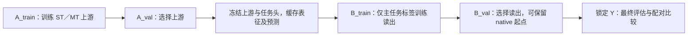

# 四个跨领域预实验的 post-refinement 结果分析

分析日期：2026-10-07。研究对象：QM9＋TinySchNet、NYUv2＋MTAN、MASSIVE＋XLM-R Base、Materials Project＋CrystalTransformer。

## 1. 主要发现与阅读范围

四个预实验尚未提供“冻结后的辅助预测读出能够跨领域稳定提升主任务”的证据。原始产物补充分析后，可以区分四种现象：**MP 的辅助监督改善了上游；QM9 的预测键关系改善了特定局部读出；MASSIVE 的辅助预测相对容量匹配组有极小、上游平均同向的增量；NYUv2 的扩展读出全部保留 native 起点。** 这些现象回答不同问题，不能合并成一个“辅助任务有效／无效”的判断。

| 实验 | 辅助监督对上游主任务的影响 | 冻结后辅助读出相对可比 embedding-only | 相对强 native 的整体效果 |
|---|---|---|---|
| QM9，20k／50k／100k | native 差异较小、方向随规模变化；随机读出下 MT 较差 | 预测键图在同容量图读出中有正增量；电荷增量弱；native 初始化后辅助摘要几乎无增量 | 随机读出明显落后；native 初始化基本持平，小规模有很小均值改善 |
| NYUv2 | 缩小版 MTAN 的 native 低于 STAN | 辅助预测、辅助 hidden 与容量匹配组的报告 mIoU 相同 | 各冻结读出基本持平，无稳定改善 |
| MASSIVE | MT-native 平均略高，但只有 3/5 上游 seed 改善 | 槽位预测平均增加 0.0726 个准确率百分点，五个上游内平均后 5/5 为正；下游初始化间方向不一致 | MT 辅助读出仍低于 MT-native，仅 1/5 上游平均改善 |
| MP | 同架构 main-only 对照下，MT-native MAE 平均降低约 0.0448 eV，5/5 seed 改善 | 形成能预测未优于容量匹配组，且弱于 shuffle | 主指标 MAE 无改善；RMSE／R² 的改善也出现在 embedding-only 中 |

本分析以四份本地集群结果汇总为数值依据，以实验设计、配置和当前源码解释读出结构。QM9 的文件名为 `cluster_run_results_zh.md`，其余三份实际为 `cluster_run_result_zh.md`。其中 QM9 包含三个规模，是一个案例的规模研究，不计为三个独立领域。

**证据边界：**四份报告记录的是实际集群多 seed 运行，不能再按早期说明中的“仅静态检查”状态解读。按用户补充授权，本次通过 `USTC_ATLAS_GPU` 只读访问 `/home/yuyang/SerialFlavour/result_in_data`（指向 `/data/yuyang/SerialFlavour/results/`），核对原始评估、配对差值、训练清单与运行身份，补充汇总未列出的辅助性能和选中 epoch。没有重新训练或按 Y 选择模型；MP 的额外 CPU 冻结推理诊断单独标明。历史 CPU smoke、旧协议和候选文献不并入本轮性能证据。原始文件哈希与聚合记录见第 9 节。

## 2. 共同协议：需要分开回答的三个问题

### 2.1 A／B／Y 与冻结边界

这些实验检验的是同一方法在不同领域是否成立：分别训练领域专用上游，再做冻结读出，并非把 jet 模型或权重直接迁移到其他领域。

ST 指真正只接受主任务监督的上游；MT 指主任务与预定辅助任务联合监督的上游。MT 的 embedding-only 已经受过辅助监督，不能当作 ST。MP 还加入了 `mt_main_only`：保留 MT 的架构，仅优化主任务损失，用来排除 ST／MT 主头结构差异。

下游使用冻结表征和冻结预测，B 的训练与选择只用主任务标签。辅助真值可以在方案锁定后的评估中用于诊断，但不能替换 B／Y 的辅助预测输入。QM9 v2 已分离 A-val 与 B-val；其设计说明中共享验证、短训练预算等描述属于历史版本。

### 2.2 三层比较及其含义

| 问题 | 主要比较 | 能回答什么 |
|---|---|---|
| 辅助监督是否有用？ | MT-native 对 ST-native；必要时对同架构 main-only | 联合训练是否改善上游主任务表现 |
| 二阶段读出是否有用？ | 同一上游的强 embedding-only 对 native | 独立 B 监督、读出结构和再优化能否改善冻结模型 |
| 辅助预测是否还有可利用的价值？ | 辅助增强对同输入层级、同容量 embedding-only，并结合 shuffle／hidden 对照 | 显式辅助输出是否在可比读出条件下提供额外的可读性或结构收益 |

只有第三项改善，才能支持辅助输出的 post-refinement 增量；同时优于 native，才说明这种增量转化为相对现有系统的实际提升。超过一个较弱的局部读出，不等于超过全局或 native 最强基线。

本文统一将“正增益”定义为改善：MAE 用“基线 MAE − 候选 MAE”，accuracy／mIoU 用“候选 − 基线”。MP 原报告使用相反的 MAE 差值方向，本文已转换。分类指标同时用百分点解释：0.000726 accuracy 等于 **0.0726 个百分点**。

### 2.3 随机种子的统计单位

每种上游有 5 个训练 seed，每个上游的每种读出有 5 个下游 seed。方法均值先在每个上游内部平均下游，再在 5 个上游均值之间汇总；上游 SD 是样本标准差，`ddof=1`。native 每个上游只有一次预测，不产生五次独立重复。

25 个上游／下游组合共享五个冻结上游，不能当作 25 个独立上游实验。配对比较应保持同一个上游与下游 seed，并优先看五个上游平均差值及其方向。MASSIVE 汇总中的辅助增量 SD=0.002375 和“13/25 为正”描述的是 25 个配对组合；它与方法表的 upstream SD 不同。远程原始数据重新按上游聚合后，该增量的 SD 为 **0.0004812，5/5 上游平均为正**，改变了对其方向一致性的判断。

这些 seed 固定同一数据划分，主要反映初始化、训练和读出的变化，没有覆盖重新抽样、重新划分或调参的不确定性。本文不从均值、SD 或 5/5 同向自行推导统计显著性，也不跨领域平均不同单位的指标。

## 3. QM9：预测关系有局部收益，但强读出下整体增量有限

依据：[QM9 结果汇总](qm9/cluster_run_results_zh.md)、[实验设计](qm9/qm9_experiment_zh.md)，以及 [模型](../experiments/qm9/model.py) 和 [读出实现](../experiments/qm9/refine.py)。

### 3.1 数据与主辅任务

QM9 案例使用小分子的原子类型、三维坐标和量子化学属性。输入是结构；主任务为分子级 HOMO–LUMO gap 回归，最终报告 MAE，单位 eV。gap 对应 LUMO−HOMO，实验禁止用 HOMO／LUMO 作为辅助，避免直接派生主标签的捷径。

数据来自原始 XYZ 归档，排除官方未表征名单中的 3,054 个分子，并按规范化 isomeric SMILES 去重。本轮是分子级随机划分，未提供骨架不重叠泛化证据。三个规模的实际分区如下：

| 总规模 | A_train | A_val | B_train | B_val | Y |
|---|---:|---:|---:|---:|---:|
| 20k | 11,200 | 1,000 | 2,800 | 1,000 | 4,000 |
| 50k | 28,000 | 2,500 | 7,000 | 2,500 | 10,000 |
| 100k | 56,000 | 5,000 | 14,000 | 5,000 | 20,000 |

辅助任务有两项，监督层级与分子级 gap 不同：

| 辅助任务 | 标签来源与输出 | 训练目标 | 需要注意的解释边界 |
|---|---|---|---|
| 逐原子 Mulliken 电荷 | XYZ 原子行中的电荷；每原子一个标量，单位 e | A_train 标准化后的 MSE | 是局部物理量，不等于直接给出 gap |
| 原子对键类型 | RDKit 根据 XYZ 推断；无序原子对的无键／单／双／三／芳香五分类 | 带类别权重的 CE | 不是另行采集的键观测；键存在与输入几何高度相关，无键类别不平衡 |

正式下游输入是预测电荷和 soft 键概率，不是 RDKit 的真值键图。电荷在缓存前反标准化为 e；图读出使用四个有键类别的概率。

### 3.2 核心架构与读出

上游为本项目的 TinySchNet 适配：原子嵌入经过基于距离的连续滤波消息传递，形成逐原子表示 H；对原子求和得到全局表示 g，再由 MLP 预测 gap。宽度 64、3 个 interaction block、32 个距离高斯基、cutoff 5.0，任务头隐藏层 64／32。ST／MT 参数量为 62,977／87,943，不使用预训练。

电荷头读入 `[h_i, g]`；键头读入 `[h_i+h_j, |h_i-h_j|, g]`，保持无序原子对的端点对称性。MT 的目标为 gap MSE＋电荷 MSE＋加权键 CE，电荷／键损失权重均为 1。原论文架构启发与本项目局部头适配需要区分，不能把这套任务组合当作 SchNet 原论文的多任务复现。

| 读出 | 核心输入与处理 | 主要比较目的 |
|---|---|---|
| native | 原冻结 gap 头，读取 g | 保留上游原始表现 |
| R0 | g＋10 个零槽，随机初始化 MLP | 全局 embedding 再读出；与 R2 匹配输入宽度 |
| R2 | g＋10 维电荷／键概率摘要 | 压缩全局输入下，辅助摘要是否更容易利用 |
| R0-native／R2-native | 对应 R0／R2 输入，从 native 主头初始化，并吸收标准化变换 | 排除丢弃已有主头造成的性能损失；B-val 可保留 epoch 0 |
| R3 | H，集合读出 | 局部表示的可读性；与 R0 不是同架构比较 |
| R3-graph | H＋零电荷槽，均匀关系图 GNN | 同容量图基线 |
| R4-nocharge | H＋零电荷槽，预测完整键概率图 | 在 H 之外检验预测关系组织 |
| R4 | H＋预测电荷，预测完整键概率图 | 完整局部辅助增强 |
| R4-uniform／existence／shuffle | 保留电荷，分别用均匀关系、仅连接概率、分子内部打乱的关系概率 | 区分连接性、键类别与关系位置的作用 |
| R1 | 原子类型嵌入＋预测电荷＋预测键图，不读取上游 H／g | 检查仅靠辅助表述的能力；远程清单确认使用边 |

R3-graph 与 R4 系列使用相同节点维度、层数和容量。`existence` 将有键总概率等分到四个关系通道；`shuffle` 在每个分子内部打乱原子对概率行，保留分布但破坏对应关系。因此它们比直接 R3→R4 更适合做结构因素分析。零槽容量匹配保证名义参数相同，不保证活跃输入方向与优化条件相同。

上游最多 500 epochs、下游最多 300 epochs，并使用 ReduceLROnPlateau。上游实际早停约 140–300 轮；100k 时 MT 平均训练 252 轮，ST 为 151 轮。MT 在该设置下需要更多优化轮次，但不能由此推广为所有多任务模型都更难训练。

### 3.3 主任务读出表现

以下是 Y MAE，越低越好；均值按上游层级聚合。

| 方法 | 20k | 50k | 100k |
|---|---:|---:|---:|
| ST-native | 0.1638 | 0.1138 | 0.0874 |
| ST-R0 | 0.2063 | 0.1516 | 0.1191 |
| ST-R0-native | 0.1636 | 0.1132 | 0.0874 |
| ST-R3 | 0.2105 | 0.1538 | 0.1208 |
| ST-R3-graph | 0.2133 | 0.1553 | 0.1219 |
| MT-native | 0.1632 | 0.1150 | 0.0879 |
| MT-R0 | 0.2112 | 0.1584 | 0.1268 |
| MT-R0-native | 0.1622 | 0.1146 | 0.0880 |
| MT-R1 | 0.3088 | 0.2809 | 0.2434 |
| MT-R2 | 0.2073 | 0.1564 | 0.1264 |
| MT-R2-native | 0.1621 | 0.1145 | 0.0880 |
| MT-R3 | 0.2205 | 0.1659 | 0.1323 |
| MT-R3-graph | 0.2208 | 0.1707 | 0.1324 |
| MT-R4 | 0.2137 | 0.1605 | 0.1274 |
| MT-R4-nocharge | 0.2122 | 0.1607 | 0.1278 |
| MT-R4-existence | 0.2192 | 0.1678 | 0.1321 |
| MT-R4-uniform | 0.2214 | 0.1704 | 0.1329 |
| MT-R4-shuffle | 0.2216 | 0.1710 | 0.1326 |

首先，native 与 native 初始化组是最强的一组。随机全局读出的误差比 MT-native 高约 0.039–0.048 eV，局部辅助图也没有弥补这一差距。R4 虽然优于 R3，却在三个规模上均弱于 R0，更明显弱于 native。这表明“局部增强有效”必须限定在局部读出比较内。

其次，随机初始化条件下 R2 相对 R0 的增益为 0.00399／0.00193／0.00045 eV，而 native 初始化后 R2 相对 R0 的增益仅 0.00012／0.00013／约 0 eV。最初看到的摘要收益在强起点下几乎消失，因而不能把它解释为整体系统未利用的稳定辅助价值。

训练清单提供了相应的选择证据：MT R0-native／R2-native 在 20k 时均为 0/25 保留 epoch 0，50k 均为 5/25，100k 则为 21/25 和 20/25。小规模可以通过 B 做轻微校准；100k 多数组保留原主头，辅助摘要并没有使更多读出获得实质改善。

ST-native−MT-native 的配对增益分别为 +0.00060、−0.00125、−0.00051 eV；随机 R0 下对应 ST−MT 为 −0.00490、−0.00679、−0.00776 eV。MT 更弱的随机读出不等于其表征本身丢失了主任务信息：native 仍能达到相近表现。另一方面，warm-start 与随机组还存在学习率、dropout、weight decay 和激活设置差异，不能把全部差距严格归因于初始化这一单独因素。

### 3.4 同容量图消融与辅助预测质量

下面的正值均表示后者 MAE 更低，单位 eV，使用源报告给出的配对差值，避免用舍入后的方法均值重新计算。

| 比较 | 隔离因素 | 20k | 50k | 100k |
|---|---|---:|---:|---:|
| R3−R4 | 局部辅助增强的合计差异，非严格同容量 | +0.00680 | +0.00545 | +0.00492 |
| R3-graph−R4-nocharge | H 之外的完整预测键图 | +0.00859 | +0.00992 | +0.00461 |
| R4-nocharge−R4 | 预测电荷 | −0.00149 | +0.00028 | +0.00039 |
| R4-uniform−R4-existence | 连接性 | +0.00219 | +0.00265 | +0.00078 |
| R4-existence−R4 | 键类别 | +0.00546 | +0.00732 | +0.00474 |
| R4-shuffle−R4 | 关系概率与原子对的对应位置 | +0.00786 | +0.01059 | +0.00522 |

键类别和关系位置的差异相对较大，连接性增量较小，电荷近乎中性。结果支持：**在该 GNN 读出中，正确组织的预测键关系比均匀或错配关系更容易用于 gap 预测。** 但不能断言获得了 H 之外的新信息：键头本身由 H 与 g 计算，而 g 是 H 的求和。

远程 `analysis/per_upstream_deltas.csv` 补充了这一结构结果的稳定性。下表每格为“增益均值 ± 五个上游 SD；改善上游数”，单位 eV；先在同一上游平均五个下游，再计方向。

| 比较 | 20k | 50k | 100k |
|---|---|---|---|
| 完整预测键图对均匀图（无电荷） | 0.00859 ± 0.00673；5/5 | 0.00992 ± 0.00371；5/5 | 0.00461 ± 0.00084；5/5 |
| 完整键类别对仅连接性 | 0.00546 ± 0.00260；5/5 | 0.00732 ± 0.00259；5/5 | 0.00474 ± 0.00105；5/5 |
| 正确关系位置对 shuffle | 0.00786 ± 0.00414；5/5 | 0.01059 ± 0.00334；5/5 | 0.00522 ± 0.00081；5/5 |
| native 初始化后辅助摘要 | 0.000121 ± 0.000081；5/5 | 0.000133 ± 0.000101；4/5 | −0.000004 ± 0.000032；1/5 |

键图、键类别和关系位置在三档的五个上游均保持改善，描述性证据比仅有总均值更强；native 初始化摘要在 100k 已无同向优势。电荷增量的改善上游数为 2/5、4/5、4/5，量级远小于关系因素。

规模趋势也应精确表述。R3→R4 的合计增益随规模减小；若看同容量键图、键类别或 shuffle 对照，50k 的增益反而高于 20k，不能说所有结构增益都单调衰减。100k 的绝对结构增益总体较小，可能与主模型精度提高、边际收益降低有关，但本轮没有隔离这些原因。

| MT 上游辅助指标，Y 均值 | 20k | 50k | 100k |
|---|---:|---:|---:|
| 逐原子电荷 MAE，e | 0.00914 | 0.00710 | 0.00600 |
| 键存在 accuracy | 0.99070 | 0.99405 | 0.99539 |
| 键存在 AUC | 0.99884 | 0.99943 | 0.99970 |
| 真实键上键级 accuracy | 0.99662 | 0.99736 | 0.99812 |

辅助误差随规模改善，但读出收益没有随辅助精度同步增大。由此可见，**辅助任务预测得准，不足以保证主任务 refinement 收益。** 电荷尤其如此：MAE 降低，没有转化成稳定的大幅主任务增益。缺少常数基线、电荷 R² 和逐 seed 对应关系，仍不能据绝对 MAE 判定电荷是否已充分学好。

键存在 accuracy 受无键多数类影响，应结合 AUC；键存在又与几何高度相关，真实键上的键类别和同容量关系消融对机制解释更有价值。这些高精度均相对于当前 RDKit 标签生成流程，不等于对独立实验测得化学键的验证。原子／原子对共享同一分子，也不能增加独立分子样本数。

### 3.5 本案例能支持的结论

QM9 是当前四个案例中最清楚的“关系组织有局部收益”证据，但不是整体 post-refinement 稳定成功的证据。强 native 起点基本持平，摘要增量极小；辅助预测图主要改善的是较弱局部读出。

原报告称 R1“无 g、无边”，但远程三档 `refiners/multi_task/seed1/R1/seed1/training_manifest.json` 均确认 `use_edges=true`、`use_atom_type=true`、`edge_features=typed_bond_probabilities`；与当前实现一致，参数量为 64,705。应将其理解为不直接读取 H／g 的辅助预测图读出。R1 较差说明在当前容量与预算下，单独的辅助表述不足以替代上游表示，不能归因于去掉了图结构。也不能由 R0 优于 R3 推断 pooling 没有丢失信息，因为二者架构、优化及有效读出难度不同。

## 4. NYUv2：缩小版密集预测下，辅助通道未产生可见增量

依据：[NYUv2 结果汇总](cv_nyu_mtan/cluster_run_result_zh.md)、[集群方案](cv_nyu_mtan/cluster_agent_handoff_zh.md)、[架构与数据说明](cv_nyu_mtan/nyuv2_mtan_smoke_test_zh.md)，以及 [读出](../experiments/cv_nyu_mtan/refine.py) 和 [评估实现](../experiments/cv_nyu_mtan/evaluate.py)。历史 smoke 只用于解释结构，不使用其性能数字。

### 4.1 数据、任务与架构

NYUv2 是室内 RGB-D 密集预测数据。本实验模型只输入 RGB，主任务是 13 类语义分割，辅助任务是逐像素深度估计与三维单位法向估计。深度／法向是监督目标和冻结预测，不能作为真值输入。法向是派生几何监督，其生成版本和物理尺度仍有未核验项。

使用固定 revision 的 `tanganke/nyuv2` 镜像，795 张训练图像分为 A_train=477、A_val=80、B_train=159、B_val=79；完整 654 张测试图像为 Y。各图像身份不重叠，但没有可靠 scene 映射，因此这是 `image_disjoint_exploratory`，不支持场景不重叠泛化结论。

上游是五级 SegNet 编码—解码骨干加任务注意力：各任务从共享特征中提取专用表示，再接 `3×3 Conv → 1×1 Conv` 预测头。STAN 仅保留分割分支；MTAN 有分割、深度、法向三个分支。当前缩小宽度为 `[16,32,64,128,128]`，分辨率 128×160，无预训练、无增强。MT 目标为分割 CE＋有效深度像素 L1＋有效法向像素 `1−cos`，任务等权。上游最多 200 epochs，读出最多 100 epochs，均按相应验证集 mIoU 选择。

这是缩小版方法验证，不是原论文全宽度配置的成绩复现。ST／MT 任务分支数量不同，未提供 MP 式同 MT 架构 main-only 对照，辅助监督与分支／计算差异不能完全分离。

### 4.2 空间读出与主任务结果

冻结基础输入为语义注意力 hidden 16 通道＋共享 decoder hidden 16 通道，保留逐像素位置。`embedding` 为 32 通道；其余读出均为 64 通道：`embedding_matched` 重复基础特征，`aux_prediction` 加深度 1 通道与法向 3 通道并用基础特征补齐，`aux_hidden` 加两个辅助分支的 hidden 共 32 通道。三种 64 通道配方使用相同卷积读出类型和容量。

所有组映射 native 分割头作为初始化，B-val 可以保留 epoch 0；native logits 用于校验而非下游输入。这避免了把空间辅助图与仅全局向量基线比较，但缓存中的最终空间特征不等于上游全部多尺度中间状态。

| 上游 | 读出 | Y mIoU | upstream SD |
|---|---|---:|---:|
| ST | native | 0.139112 | 0.008446 |
| ST | embedding | 0.139364 | 0.008164 |
| ST | embedding_matched | 0.139255 | 0.008213 |
| MT | native | 0.132604 | 0.005680 |
| MT | embedding | 0.132347 | 0.005635 |
| MT | embedding_matched | 0.132624 | 0.005691 |
| MT | aux_prediction | 0.132624 | 0.005691 |
| MT | aux_hidden | 0.132624 | 0.005691 |

MT-native 相对 ST-native 低 0.006508，即 **0.6508 个 mIoU 百分点**。远程原始数据给出的五个上游配对 SD 为 0.005206，**5/5 上游均下降**，是本设置下方向一致的负向多任务结果；本文不据此自行宣称统计显著。

冻结后的差异很小：ST embedding 相对 native 增加 0.0252 个百分点，MT embedding 减少 0.0257 个百分点。远程训练清单确认：MT `embedding_matched`、`aux_prediction`、`aux_hidden` 各自的 **25/25 读出均选择 epoch 0**，共 75 个；MT embedding 则为 24/25。三个 64 通道组在同 seed 配对下的 Y 混淆矩阵完全相同，辅助增量确为零。这比只观察舍入后的 mIoU 相同更明确：新增辅助通道的训练没有被 B-val 接受。

三个扩展组相对原 native 仍有约 0.000020 的 mIoU 均值差异，其混淆矩阵并非完全等同于原 native。既然保留了 epoch 0，这种差异不能记为学习收益；结合已记录的卷积通道扩展和跨设备数值风险，应作为初始化／推理数值一致性问题看待，不能用它宣称 refinement 改善。

### 4.3 辅助性能与整体效果

集群汇总未列辅助性能，但远程 `evaluation.json` 已包含五个 MT-native 的对应结果：

| MT-native 辅助指标 | 五个上游均值 | upstream SD |
|---|---:|---:|
| 深度绝对误差，原标签数值尺度 | 0.762878 | 0.025237 |
| 深度相对误差 | 0.317545 | 0.024208 |
| 法向平均角误差，度 | 38.8036 | 0.4170 |
| 每 seed 法向中位角误差的均值，度 | 35.8340 | 0.4428 |

深度相对误差约 31.75%，法向平均角误差约 38.8°，辅助几何预测仍有明显误差，不能把本例描述为“高质量几何已全部被分割头利用”。深度物理单位尚未独立核验，故不将绝对误差擅自标为米；中位角这一行是各模型中位数的平均，不是汇总所有模型／像素后的单一中位数。

Y mIoU 约为 13.3%–13.9%，整体分割水平有限。结合辅助误差与全部扩展组保留 epoch 0，更合理的解读是：当前较弱的上游、仅 159 张 B_train 和这一卷积读出条件下，没有检测到可验证的辅助增量。辅助 hidden 也未获选择，不证明几何任务普遍没有分割价值。要区分弱预测、读出能力或样本不足的原因，仍需训练／验证轨迹、几何基线和更严格的确认条件。

源报告还记录了初始化校验的跨 CPU／GPU 数值一致性风险：CPU 读出仍与 GPU 缓存 logits 比较。已完成的集群结果不因此自动失效，但该校验尚未证明在其他设备或 checkpoint 上可靠；它属于复现稳健性限制，不应被当作本轮无增益的已证实原因。

## 5. MASSIVE：槽位预测有极小的同向增量，但没有提升 native

依据：[MASSIVE 结果汇总](nlp_massive_xlm/cluster_run_result_zh.md)、[实验定位](nlp_massive_xlm/experiment_scope_zh.md)、[集群方案](nlp_massive_xlm/cluster_agent_handoff_zh.md)，以及 [读出](../experiments/nlp_massive_xlm/refine.py)、[统计](../experiments/nlp_massive_xlm/analysis.py) 和 [评估实现](../experiments/nlp_massive_xlm/evaluate.py)。

### 5.1 数据与主辅任务

本实验只使用 MASSIVE 1.0 的 en-US 文本。主任务为 60 类句子意图分类；辅助任务为词级槽位分类，输出 56 种类型，包含 Other。56 个类别属于一个辅助任务，不能写成 56 个独立辅助任务，也不是 111 类 BIO 标签头。

官方 train／dev／test 为 11,514／2,033／2,974。按源 ID 和规范化文本绑定重复组，优先保留 test，再 dev、train，剔除 38 条跨分区重复记录；审计发现 88 个重复组、7 个意图冲突组。实际分区为 A_train=8,621、A_val=1,029、B_train=2,860、B_val=999，Y 保留完整官方 test=2,974。输入仅为文本，不加入带槽位标记的文本、真实槽位或 scenario。

槽位监督只作用于每词首子词，忽略续子词、特殊 token 和 padding；它提供局部语义监督，而意图是全句目标。句子中的多个槽位词不构成多个独立句子样本。B_train 平均每意图约 48 句只是规模量级，不能推断实际类别均衡。

### 5.2 XLM-R 与冻结读出

上游使用作者的并行意图／槽位双头 `XLMRIntentClassSlotFill`，共享公开基础预训练 XLM-R Base：12 层、hidden 768、12 attention heads、FFN 3072。意图头使用 masked mean 聚合，槽位头逐 token 分类。ST 只优化 intent CE、冻结槽位头；MT 优化 intent CE＋首子词 slot CE，槽位权重为 1。共享 encoder 在 A 上微调，最多 20 epochs。

本轮是预训练迁移条件下的单语言验证，与另外三个从头训练案例不同。公共预训练／tokenizer 可能接触 B／Y 文本，未完成逐样本语料重叠审计；已经控制的是本轮任务微调与二阶段标签暴露，不能宣称完全无预训练输入暴露。

下游逐 token 进行 Linear–GELU 投影至 32 维，再 masked mean／max pooling，用 residual classifier 加到所有组共同可见的冻结 native intent logits 上。残差输出层初始为零，epoch 0 复现 native，B-val 可以保留该起点。

| 读出 | token 输入 | 下游可训练参数 | 核心作用 |
|---|---|---:|---|
| embedding | 完整 token H，768 维 | 28,508 | 强序列表征基线 |
| embedding_matched | H＋重复 H 的 56 个通道，824 维 | 30,300 | 控制辅助组增加通道／参数的影响 |
| aux_prediction | H＋56 维冻结 slot softmax，824 维 | 30,300 | 检验显式槽位表述的增量 |

额外通道使用相同的文本词首 mask；基础 H 保留完整 token 输入。这里辅助预测是完整 H 的确定性函数，可能改变有限读出的学习便利性，不能提供 H 之外的新 Shannon 信息。

### 5.3 读出表现与稳定性

| 上游 | 读出 | Y intent accuracy | upstream SD |
|---|---|---:|---:|
| ST | native | 0.877808 | 0.003060 |
| ST | embedding | 0.877485 | 0.002902 |
| ST | embedding_matched | 0.877606 | 0.003488 |
| MT | native | 0.880161 | 0.003983 |
| MT | embedding | 0.878386 | 0.003473 |
| MT | embedding_matched | 0.878467 | 0.003021 |
| MT | aux_prediction | 0.879193 | 0.003217 |

MT-native 相对 ST-native 的源报告配对均值为 +0.002354，即 +0.2354 个百分点；五个上游配对 SD 为 0.005958，只有 3/5 为正。这是略正但不稳定的上游多任务观察。

槽位辅助读出相对 MT embedding_matched 增加 0.000726，即 **0.0726 个百分点**。25 个配对组合只有 13 个为正，配对 SD 为 0.002375，个别组合下降约 0.6 个百分点。不过，这不能代替上游层级判断：重新在每个上游内平均五个下游后，**五个上游的辅助增量全部为正，SD 为 0.0004812（0.0481 个百分点）**。因此原汇总“方向不稳健”的描述需要细化为：下游初始化组合间不一致，但五个上游平均具有一个极小的同向信号。

MT aux_prediction 相对 MT-native 反而下降约 0.0968 个百分点，上游配对 SD 为 0.1531 个百分点，只有 1/5 上游平均改善。对 Y 的 2,974 句而言，0.000726 的准确率差约对应每模型平均 2.16 句的正确数差异；这是帮助理解效应量的换算，不代表所有 seed 都在相同两句话上改善。尚无预先设定的最小实用效应、独立划分重复或多比较控制，不能把 5/5 同向自动写成普遍或显著收益。

训练清单还确认，MT aux_prediction 仅 4/25 选择 epoch 0，容量匹配组为 2/25。与 NYUv2 不同，多数读出确实采用了训练后的修正；“微小增量”不能统一归因为全部退回 native。

### 5.4 辅助性能与整体效果

远程 `evaluation.json` 补齐了本轮 MT-native 的 slot span micro-F1=**0.773458 ± 0.012328**，semantic frame accuracy=**0.685071 ± 0.012792**，均为五个上游的均值与样本 SD。span 指标按首子词还原词级连续同类型 span，排除 Other，不采用 BIO head；frame accuracy 同时要求意图和整句槽位正确，不能当作纯槽位指标。

| 上游 seed | 槽位 span F1，% | 辅助读出对容量匹配组增量，准确率百分点 |
|---|---:|---:|
| 17 | 76.6268 | +0.1076 |
| 23 | 79.3109 | +0.1345 |
| 41 | 76.4737 | +0.0672 |
| 59 | 76.4993 | +0.0269 |
| 73 | 77.8181 | +0.0269 |

约 77.35% 的 span F1 说明槽位头已学到一定语义结构，但仍有抽取误差，且预测质量较高不保证对意图的额外价值。五个 seed 数量太少，不能从这张表建立槽位精度与 refinement 效果的稳健相关关系。预训练、native 残差起点和有限 B 样本可能使边际收益较小，当前分析没有隔离其因果作用。

本案例的准确结论是：相对同容量完整 token 读出，槽位概率呈现一个极小、上游平均同向的增量；相对 MT-native 没有整体收益。它是有限条件下的可读性线索，尚不构成实用或跨领域普遍收益证据，也不是多语言迁移验证。

## 6. Materials Project：多任务上游明显获益，冻结辅助读出未获益

依据：[MP 结果汇总](sci_mp_crystran/cluster_run_result_zh.md)、[集群方案](sci_mp_crystran/cluster_run_zh.md)、[训练与数据风险](sci_mp_crystran/training_data_risks_zh.md)，以及 [模型](../experiments/sci_mp_crystran/model.py)、[读出](../experiments/sci_mp_crystran/refine.py) 和 [评估实现](../experiments/sci_mp_crystran/evaluate.py)。

### 6.1 数据与任务

本实验使用 MP 2018-10-18 固定快照中的晶体结构和计算性质。主任务为材料级 PBE 带隙 Eg，单位 eV；辅助任务为材料级形成能 Ef，单位 eV/atom。二者都是材料整体标量，不存在逐原子辅助真值。PBE 带隙是当前计算标签，不应写成直接预测实验测量的真实带隙。

准备阶段扫描 83,989 条记录，选取 40,000 候选，按 material ID 与 StructureMatcher 去重，剔除 1,065 个等价结构，最终选择 20,000 个材料；报告另记录原子数过滤剔除 7,857 条。不同计数对应筛选流程中的不同集合，不应简单相减推导最终样本量。每晶胞最多 64 原子。

分区为 A_train=11,200、A_val=1,000、B_train=2,800、B_val=1,000、Y=4,000。结构去重后做材料级随机划分，不是组成不重叠协议。Eg／Ef 目标标准化只拟合 A_train，下游输入统计拟合 B_train。20k 是所有分区总量，不能把 20k 都称为上游训练样本。

### 6.2 CrystalTransformer 与匹配对照

模型将原子序数的 100 维 one-hot 和笛卡尔坐标分别投影，拼成 64 维原子 token，经过 4 层、4 heads、FFN 128 的 Transformer。它取 **第一原子 token 的表示 `H[:,0]` 为 g**，并非额外学习的 CLS token 或对所有原子求和。

作者 ST 主头由两层无激活线性层组成；MT 的 Eg／Ef 分别使用 Linear–ReLU–Linear 头。因此实验保留三种上游：作者 ST、同 MT 结构但仅 Eg 损失的 `mt_main_only`、Eg＋Ef 标准化 MSE 的 `multi_task`。这是四案例中最直接隔离辅助监督与头架构变化的对照。

当前宽度／深度缩小，ST 145,697 参数、MT 145,698 参数，不加载预训练。它未显式建模周期邻居；结构排序、平移、旋转等对称性没有得到可靠控制，历史 smoke 已观察到敏感性。当前结果只适用于这一具体结构表示与锁定划分，不是作者默认规模的精确复现。

所有下游组共同读取完整 H、g 和 native Eg。H 经逐原子 64→128 投影后 masked mean pooling，再与 64 维 g、native Eg、一个额外标量拼成 194 维输入，接 128／64／32 的残差 MLP，共 43,649 个可训练参数。最后一层零初始化，使 epoch 0 等于 native。

| 读出 | 共同输入之外的额外标量 | 比较目的 |
|---|---|---|
| embedding | 零 | 完整 H／g 的残差再读出 |
| embedding_capacity | g 的一个重复通道 | 与辅助组匹配输入宽度和可训练参数 |
| embedding_aux | 冻结 Ef 预测 | 形成能输出的增量 |
| embedding_aux_shuffle | 分区内打乱后的 Ef 预测，重新训练 | 检查材料对应关系是否有价值 |
| embedding_hidden | Ef 分支 hidden 的一个通道 | 单通道任务 hidden 诊断 |

`embedding_hidden` 只取一个 hidden 通道，不能据它的负结果推断完整 Ef 分支表示也无用。辅助 Ef 预测由 g 确定；完整 H／g 已共同可见，其潜在价值在读出表述和优化，而不在新增信息。

### 6.3 主指标与上游收益

| 上游 | 读出 | Y MAE，eV | upstream SD | RMSE，eV | R² |
|---|---|---:|---:|---:|---:|
| ST | native | 0.580174 | 0.012731 | 0.983500 | 0.591272 |
| ST | embedding | 0.580936 | 0.013041 | 0.977049 | 0.596581 |
| ST | embedding_capacity | 0.581756 | 0.013139 | 0.976245 | 0.597234 |
| mt_main_only | native | 0.583045 | 0.003370 | 0.993312 | 0.583372 |
| mt_main_only | embedding | 0.584771 | 0.002065 | 0.983449 | 0.591588 |
| mt_main_only | embedding_capacity | 0.583803 | 0.002388 | 0.982053 | 0.592752 |
| MT | native | 0.538222 | 0.008495 | 0.953544 | 0.616033 |
| MT | embedding | 0.539733 | 0.010975 | 0.926069 | 0.637757 |
| MT | embedding_capacity | 0.538423 | 0.011422 | 0.925690 | 0.638060 |
| MT | embedding_aux | 0.539977 | 0.012988 | 0.927634 | 0.636506 |
| MT | embedding_aux_shuffle | 0.538932 | 0.012716 | 0.925828 | 0.637930 |
| MT | embedding_hidden | 0.540170 | 0.012073 | 0.927884 | 0.636318 |

MT-native 相对同架构 main-only 的 MAE 降低 **0.044823 eV，约 7.69%**；相对作者 ST 降低 **0.041953 eV，约 7.23%**。五个上游 seed 均改善，对同架构 main-only 的配对 SD 为 0.009516 eV。这是本轮最稳定的上游辅助监督收益，但仍是固定划分下的描述性证据，未实施显著性检验。

关键在于，这一上游收益没有转化成 B 阶段显式 Ef 输入的收益。按本文“正值＝改善”的口径：

| 候选相对基线 | MAE 增益，eV | 五个上游配对 SD | 改善的上游 seed |
|---|---:|---:|---:|
| MT embedding 对 MT-native | −0.001512 | 0.003447 | 1/5 |
| MT aux 对 MT embedding_capacity | −0.001554 | 0.002367 | 2/5 |
| MT aux 对 MT embedding | −0.000244 | 0.002235 | 2/5 |
| MT aux 对 MT shuffle | −0.001045 | 0.000747 | 0/5 |
| MT aux 对 MT hidden | +0.000193 | 0.001677 | 3/5 |

真实对应的 Ef 预测甚至在 5/5 上游平均结果中弱于 shuffle。它不说明“打乱辅助预测普遍更好”，但说明本设置下未观察到正确材料—形成能对应关系被有效利用的证据。

MT embedding、capacity、aux、hidden 均只有 4/25 选择 epoch 0，shuffle 为 3/25，多数读出采用训练后的修正。与 NYUv2 的全部回退不同，MP 的无辅助增量不能简单归因为未进行有效读出更新。实际 `resolved_config.json` 与训练清单记录的下游早停 patience 为 10，scheduler patience 为 4，上游 scheduler patience 为 8；早期集群说明中的其他规划数值不替代这份实际配置。

### 6.4 MAE 与 RMSE 的分歧、辅助任务缺口

MT embedding_capacity 的 RMSE 从 native 的 0.953544 降到 0.925690，R² 从 0.616033 升到 0.638060，但 MAE 略高。RMSE 对大误差更敏感，这组结果与较大误差被压缩、整体绝对误差略增的残差重分配相容；具体是否由尾部改善造成，还需要逐样本误差分布验证。

当前下游以标准化 MSE 优化、以 B_val MAE 选择，这与指标分歧的方向相容，但没有单因素实验来确认原因。更重要的是，RMSE 改善已经由 embedding-only 实现，辅助 Ef 组的 RMSE 0.927634 反而弱于容量匹配组 0.925690。因此，即使讨论次指标校准收益，也不能归因于辅助预测。

集群汇总和当前 `evaluate.py` 没有输出 Ef 指标，远程结果目录中的缓存也已经不在，因此不能直接从旧评估表获得形成能质量。本次采用保存的五个 MT `best.pt`、`prepared.json`、锁定 Y 的材料顺序与 A_train 标准化参数，在 **CPU／eval／inference mode** 下重算冻结主／辅预测，不训练、不做模型选择、不写远程结果。

这是一项新增诊断，不是原始集群 evaluate 已报告的数字。模型源码与本地已审查实现 SHA256 一致，checkpoint identity 与原评估一致；同时复算的 Eg MAE 与原 GPU 评估逐 seed 的最大差异为 **4.99×10⁻⁹ eV**，提供了加载、标签单位和样本对齐的交叉核对。

| 形成能 Y 指标 | 五个冻结 MT 上游，均值 ± SD | A_train 均值常数基线 | A_train 中位数常数基线 |
|---|---:|---:|---:|
| MAE，eV/atom | 0.186112 ± 0.008694 | 1.077809 | 1.075239 |
| RMSE，eV/atom | 0.302065 ± 0.008723 | 1.281402 | 1.284869 |
| R² | 0.944391 ± 0.003209 | −0.000056 | −0.005475 |

Ef MAE 相对 A_train 中位数常数降低约 **82.69%**，五个 seed 的 R² 为 0.9404–0.9478。它在本锁定材料划分下已经具有较强的辅助预测能力，“Ef 头根本没学好”因而不再是解释无增量的主要证据。仍不能据此声称跨组成或对称性变换也有相同质量。

MP 提供了四例中最清楚的区分：**辅助监督改善主任务，辅助头自身预测良好，但显式辅助预测在冻结后仍未优于强表征读出。** 该结果与有用因素已进入 native／H、Ef 对剩余 Eg 误差的互补性有限、或有限读出未利用该互补性等解释相容，不能由辅助高 R² 直接证明知识已被完全利用。

## 7. 跨领域综合：post-refinement 证据应如何解释

### 7.1 上游正迁移不是下游辅助收益的充分条件

MP 的正迁移最清楚，但其冻结 Ef 读出没有增量。MASSIVE 的上游均值略正而不稳定，下游差异同样很小；NYUv2 上游为负，辅助读出未恢复劣势；QM9 native 基本持平，局部关系读出仍能出现正增量。这些结果不支持“只要上游多任务有收益，post-refinement 就应有收益”的推理。

反过来，当前数据也不能验证上游正迁移是否是 refinement 的必要条件。不同案例任务层级、输入表示、样本数和读出结构同时变化；不能用四个异质案例建立必要性或因果关系。

### 7.2 强基线改变了“辅助任务还有多少价值”的判断

QM9 最能说明基线的重要性：R4 相对 R3 有约 0.005–0.007 eV 的收益，但仍弱于 R0；R2 相对随机 R0 有收益，native 初始化后几乎消失。NYUv2／MASSIVE／MP 则保留 native 起点，减少了丢弃已学主头导致的无谓退化。

保留 epoch 0 意味着 native 是 **B_val 选择时**的候选，不保证所选模型在 Y 上必然优于 native。验证选择存在有限样本波动，因此略差的 Y 表现并不自动说明实现出错。也不能用“B-val 未选中新增通道”证明这些通道在任何读出中都无价值。

基线还应匹配输入层级。逐 token／逐像素／逐原子的辅助组，不能只与弱全局 MLP 比较；本文四个案例已经不同程度加入局部或完整 H 输入控制。容量匹配则只是比较的必要条件之一，不保证训练轨迹、激活输入方向和函数复杂度完全等价。

### 7.3 辅助输出的可能价值在于结构与可读性，不能统一称为新增信息

MASSIVE 的 slot 概率是完整 token H 的确定性函数；MP 的 Ef 是 g 的确定性函数；QM9 的电荷与键概率由 H／g 计算。对足以确定这些预测的完整冻结表示而言，预测本身不新增 Shannon 信息。有限容量、有限 B 样本的读出仍可能从任务专用非线性变换或结构归纳偏置中获益，这与信息不增加并不矛盾。

相对压缩 g，QM9 的局部／关系输出可以暴露由 H 承载、全局压缩未便于保留的结构；因此必须明确“相对哪一种输入”的增量。NYUv2 的基础缓存则只有最终语义／共享空间特征，不能未经证明就认为它足以恢复所有多尺度辅助分支输出。该案例的 hidden 对照也是输入访问控制，而非完整信息等价性的证明。

当前结果中，QM9 的键关系是最值得保留的结构机制线索：类型与对应位置比单一电荷更有读出价值，且三个规模的五个上游平均均同向。但它仍没有超过强 native，尚需更强局部基线与 native 兼容图残差对照，不能将其写成普遍成功机制。MASSIVE 则给出极小的非线性任务表述收益，其实践价值与跨划分可重复性仍未确定。

### 7.4 四个负／微小结果不能证明“辅助任务已耗尽”

post-refinement 是受限条件下的探针。观察到增益可以说明特定读出仍能利用冻结产物改善目标；观察不到增益，只能说明当前输入、架构、样本量、优化与选择条件下没有检测到增益。

若要进一步声称 auxiliary-task exhaustion，需要排除读出能力不足、辅助预测不足、B 数据不足和选择噪声等替代解释。本次补齐四例辅助诊断后，MP 的“辅助预测质量不足”解释受到较强限制，NYUv2 的几何误差仍明显，MASSIVE 的槽位预测已有一定质量，QM9 的键预测接近饱和。但即使辅助头准确，也未证明所有主任务相关因素都已进入最优读出，仍不足以得出“辅助任务已学好且全部被主头利用”的完整证据链。

### 7.5 当前跨领域验证的贡献与结论边界

本轮跨领域验证的价值在于：同一 A／冻结／B／Y 问题得到多种上游架构、监督层级和训练条件下的实际检验，并通过强基线识别出“联合监督收益”“读出重优化收益”和“预测关系组织收益”的区别。

可用于研究记录的结论是：

> 在当前四个预实验中，多任务监督与冻结后辅助读出的效应并不一致。MP 的形成能监督稳定改善上游带隙预测，形成能预测本身也较准确，但显式形成能输入未优于同容量完整表征读出。QM9 的预测键类别与关系位置在三个规模的同容量局部图读出中均有五个上游平均同向的增量，却未超过强 native；native 初始化后的辅助摘要收益随规模接近零。MASSIVE 的槽位概率相对同容量读出有极小同向增量，但整体低于 MT-native。NYUv2 的扩展读出全部保留 epoch 0，未检测到辅助增量。因此，这些结果支持按案例分析结构与可读性条件，尚不支持辅助预测 post-refinement 的普遍有效性，也不能据此判定辅助任务信息已被完全利用。

## 8. 证据缺口与后续分析优先级

本轮已经补齐原始配对统计、选中 epoch、NYUv2／MASSIVE 辅助指标，以及 MP 冻结 CPU 诊断；下面列出的仍是后续待办，没有修改训练配置或启动新训练。既有 Y 结果已经被阅读，任何据此形成的新设计都应作为探索性方案，使用新实验身份和另行锁定的验证／确认策略。

| 优先级 | 需要补充的证据 | 用途与限制 |
|---|---|---|
| 1 | 四例的 B_train／B_val 轨迹及训练前后误差变化 | 现已明确各组是否退回 epoch 0；进一步分开优化未改善、验证选择和 Y 泛化变化 |
| 1 | NYUv2 几何常数／简单基线、类别级分割分析与场景身份 | 判断弱主／辅模型与场景相关性的作用；不以图像独立代替场景独立 |
| 1 | QM9 电荷基线／R²、MASSIVE 槽位错误类型、MP Ef 与 Eg 剩余误差的对应关系 | 高辅助性能不直接说明与主任务剩余误差互补；只作预先限定的诊断，不按 Y 选择新模型 |
| 2 | 每上游 B_train／B_val 轨迹、native 起点、输入量级和读出选择 | 分析容量、过拟合和优化；不能仅凭无收益就假定这些问题已发生 |
| 2 | MP 逐样本绝对／平方误差分布 | 确认 MAE 与 RMSE 分歧的来源，单列 embedding 校准与辅助增量 |
| 3 | 独立的新确认条件：读出能力、B 样本效率、适用分组划分 | 检验当前负结果是否依赖预算或分布；不按已有 Y 反复挑选“有效”架构或任务 |

QM9 应优先检验关系收益能否转化到强主头起点；MP 应分开上游正迁移、下游校准与剩余误差互补性；NYUv2 应解释低分割质量和扩展读出的全部回退；MASSIVE 应验证极小同向效应是否达到预先设定的实用标准，并在独立划分上复核。这些问题比简单寻找一个正结果更能推进机制判断。

## 9. 本地证据索引与版本口径

| 案例 | 本轮性能来源 | 运行身份 | 设计／实现补充 |
|---|---|---|---|
| QM9 | [cluster_run_results_zh.md](qm9/cluster_run_results_zh.md) | `qm9_gap_charge_bond_refine_v2_20k`／`_50k`／`qm9_gap_charge_bond_refine_v2`（100k） | [设计](qm9/qm9_experiment_zh.md)、[100k v2 配置](../experiments/qm9/config/qm9_gap_charge_bond_refine_v2_100k.json)、[refine.py](../experiments/qm9/refine.py) |
| NYUv2 | [cluster_run_result_zh.md](cv_nyu_mtan/cluster_run_result_zh.md) | `cluster_full_image_v2` | [集群说明](cv_nyu_mtan/cluster_agent_handoff_zh.md)、[model.py](../experiments/cv_nyu_mtan/model.py)、[evaluate.py](../experiments/cv_nyu_mtan/evaluate.py) |
| MASSIVE | [cluster_run_result_zh.md](nlp_massive_xlm/cluster_run_result_zh.md) | `xlmr_base_en_us_full_v2` | [实验定位](nlp_massive_xlm/experiment_scope_zh.md)、[集群说明](nlp_massive_xlm/cluster_agent_handoff_zh.md)、[model.py](../experiments/nlp_massive_xlm/model.py)、[evaluate.py](../experiments/nlp_massive_xlm/evaluate.py) |
| MP | [cluster_run_result_zh.md](sci_mp_crystran/cluster_run_result_zh.md) | `mp_crystran_cluster_20k_v2` | [集群说明](sci_mp_crystran/cluster_run_zh.md)、[数据风险](sci_mp_crystran/training_data_risks_zh.md)、[model.py](../experiments/sci_mp_crystran/model.py)、[refine.py](../experiments/sci_mp_crystran/refine.py) |

共同分析原则来自 [cross-domain 工作约定](../AGENTS.md)、[pipeline](PIPELINE.md) 和 [案例建议中的比较协议](cross_domain_case_studies_zh.md)。候选文献与创新性讨论不作为本轮实验实证，也未在本次进行新的外部文献检索。

### 9.1 本次远程补充分析的可审计记录

- [原始结果与训练清单聚合记录](cross_domain_preliminary_results_audit_20261007.json)：记录四案例、QM9 三档的运行身份、原始文件路径／SHA256、上游配对均值与 SD、读出 epoch 0 数量及 NYUv2／MASSIVE 辅助指标。NYUv2／MASSIVE／MP 原评估分别为 160／135／240 行，身份与各自运行清单及读出训练清单一致。
- [MP 形成能 CPU 冻结推理诊断](mp_auxiliary_cpu_audit_20261007.json)：记录五个上游的 Ef／Eg 指标、A_train 常数基线、原 Eg 结果交叉核对、prepared／split／normalization／模型源码／checkpoint 的 SHA256。使用原集群环境 PyTorch 2.2.1+cu121，但推理设备明确为 CPU，4 个线程；不使用 GPU、不重新训练、不写远程产物。

远程路径均位于用户指定结果入口下：NYUv2 为 `cv_nyu_mtan/cluster_full_image_v2/`，MASSIVE 为 `nlp_massive_xlm/xlmr_base_en_us_full_v2/`，MP 为 `sci_mp/sci_mp_crystran/mp_crystran_cluster_20k_v2/`，QM9 为 `qm9/<各档实验名>/`。补充统计未修改原始集群结果，原报告中的 R1 描述及 MASSIVE 方向判断在本文中明确校正。

较早设计文件仍保留“尚未执行”、QM9 历史共享验证、旧目录路径或 NYUv2／MASSIVE v1 名称。这些文字应按记录时间理解：本轮性能采用上表实际集群结果身份，架构解释采用相应设计与当前实现交叉核对；需要精确复现时仍应使用集群保存的 `resolved_config`、manifest 与源码身份。本文没有修改这些历史说明、用户已有 QM9 文档变更或实验代码。
